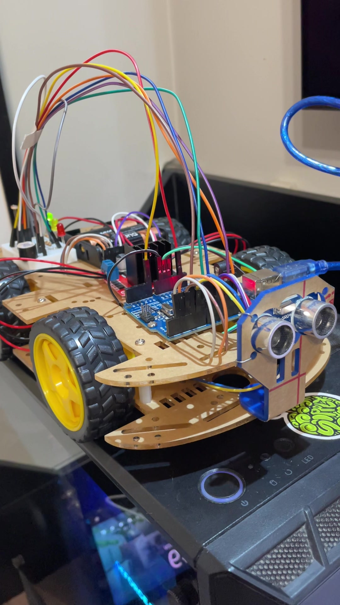
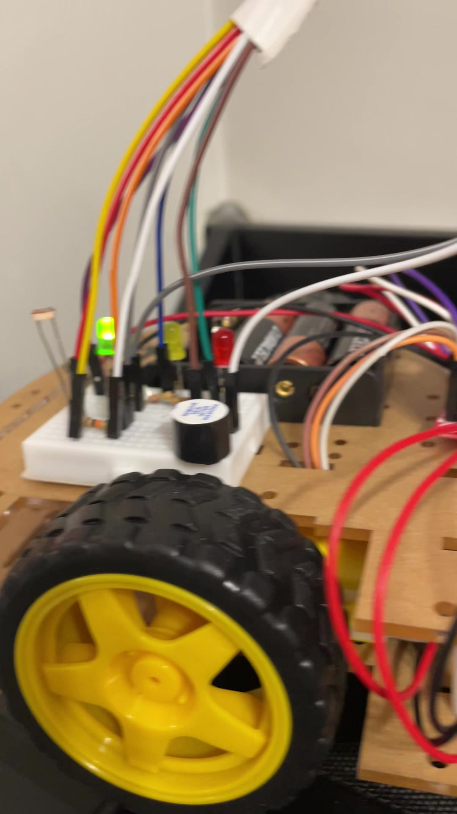
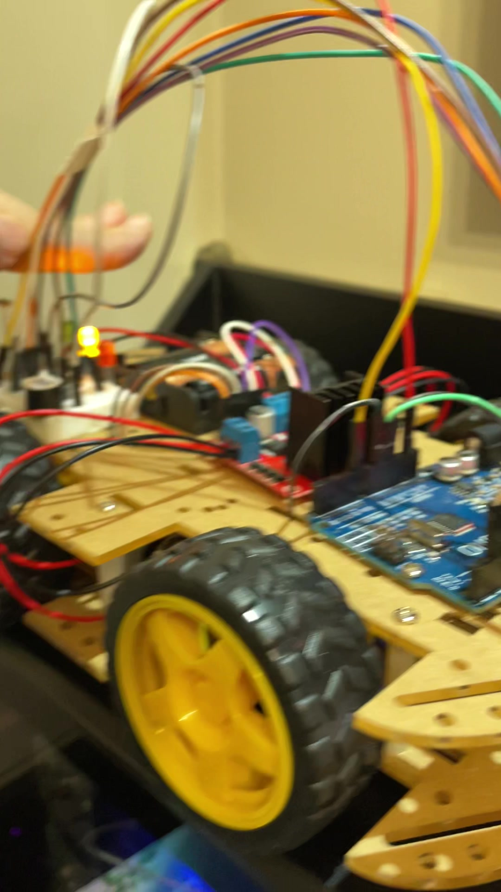
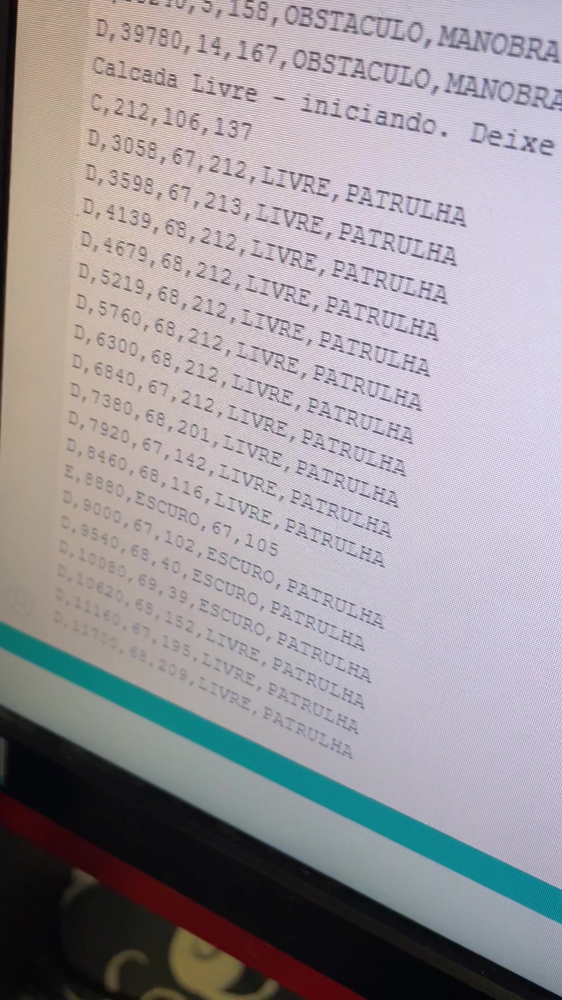
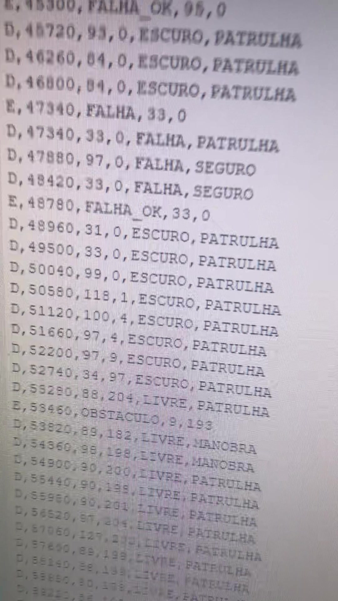
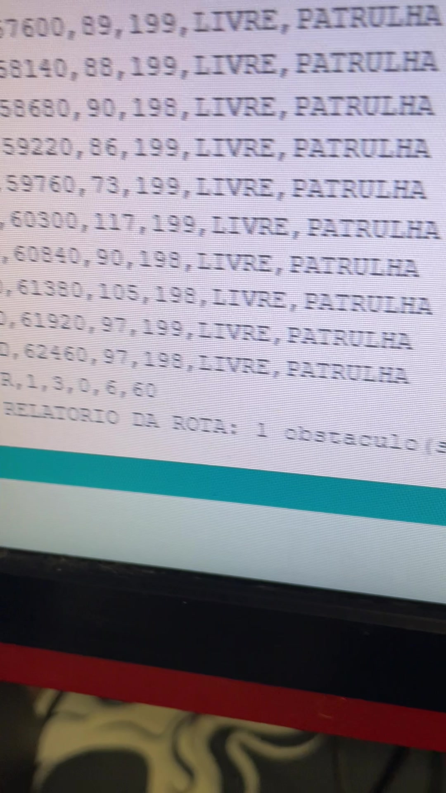
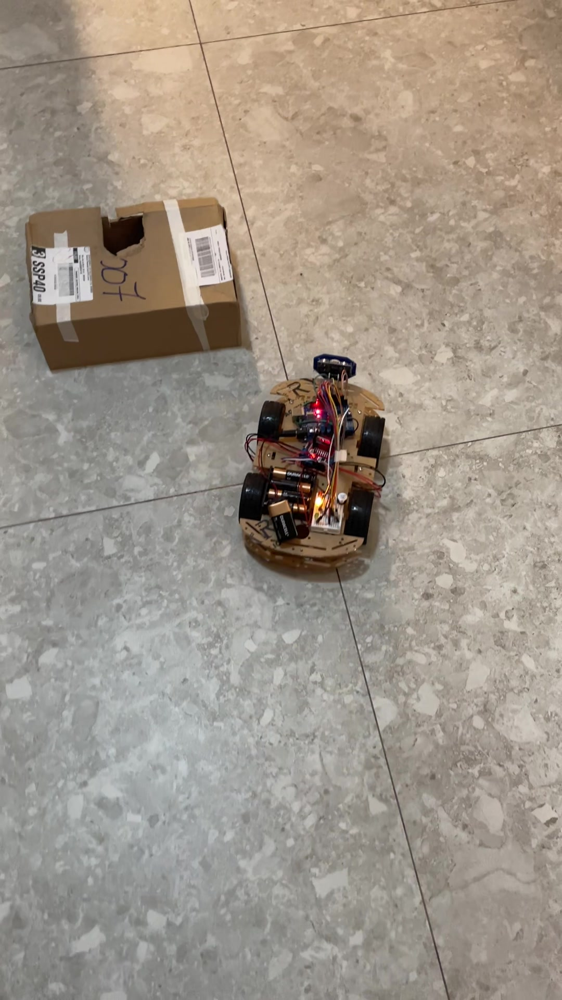
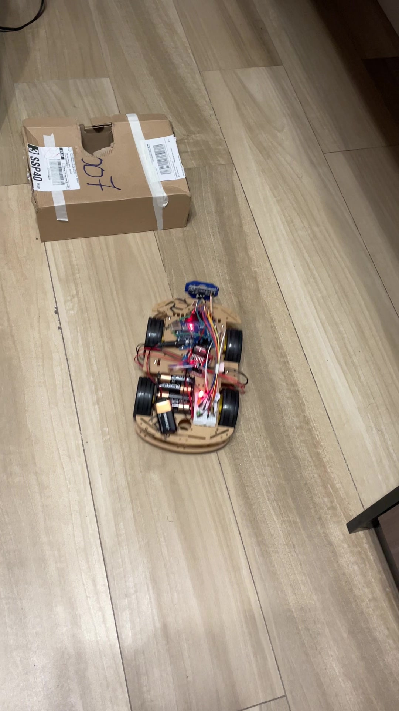

# 🚶 Calçada Livre — carrinho inspetor de calçadas

**Project-Based Maker Lab · Global Solution 2026.2 · CitizenTech · Engenharia de Software 4º ano**
Evolução do robô 4WD da disciplina (Etapa 1) com um **sensor adicional de luminosidade (LDR)**.

## 👥 Integrantes

| Nome | RM |
|------|-----|
| Paulo Lopes | 551137 |
| Gustavo Melo | 98809 |
| Lucas Bandeira | 98640 |
| Carlos Ganzerli | 99840 |

**🎥 Vídeo demonstrativo (até 6 min):** PREENCHER (link do YouTube) · **Repositório:** PREENCHER

## O problema (CitizenTech)
Calçadas com obstáculos e trechos mal iluminados limitam a circulação de pedestres, especialmente idosos e pessoas com deficiência. Segundo o Censo 2022 do IBGE, o Brasil tem **14,4 milhões de pessoas com deficiência** ([IBGE, Agência de Notícias](https://agenciadenoticias.ibge.gov.br/agencia-noticias/2012-agencia-de-noticias/noticias/43463-censo-2022-brasil-tem-14-4-milhoes-de-pessoas-com-deficiencia)). Hoje esses problemas costumam ser conhecidos só depois de uma reclamação.

**Cidadão beneficiado:** pedestres, com atenção a idosos e pessoas com deficiência, e o agente público de zeladoria.
**ODS:** 11 (meta 11.7: espaços públicos seguros, inclusivos e acessíveis), 9 (9.1: infraestrutura de qualidade) e 10 (10.2: inclusão).

## A solução
Um carrinho que **patrulha uma rota, detecta obstáculos (ultrassônico) e trechos escuros (LDR), reage sozinho e avisa** quem está por perto com LEDs e buzzer. No fim da rota, imprime um relatório com o que encontrou.

| Situação | Motores | LED | Buzzer |
|---|---|---|---|
| Livre | Normal | Verde | Mudo |
| Trecho escuro | Mais lento | Amarelo | 1 bip curto |
| Obstáculo | Para, ré e desvio | Vermelho | 2 bips |
| Obstáculo no escuro (risco alto) | Para até normalizar | Vermelho piscando | Alarme contínuo |
| Falha de sensor (modo seguro) | Para | Todos piscando | 3 bips repetidos |

Diagrama de estados e acessibilidade: [`docs/maquina_de_estados.md`](docs/maquina_de_estados.md).

### Sensor adicional: LDR
O ultrassônico já fazia parte da Etapa 1. O **novo sensor é o LDR**, que mede a luz do trecho. Ele **calibra sozinho ao ligar**: o limite de "escuro" é uma fração da luz medida no ambiente, então funciona com iluminações diferentes. Valores e motivos: [`docs/limiares.md`](docs/limiares.md).

## Hardware
Componentes novos: **LDR de 5 mm, resistor de 10 kΩ, buzzer ativo de 5 V e 3 LEDs (verde, amarelo e vermelho) com resistores de 220 Ω**, montados na mini protoboard do kit. Nada é impresso em 3D.
Ligações: [`hardware/esquema_ligacao.md`](hardware/esquema_ligacao.md) · Fixação: [`hardware/fixacao_sem_impressao.md`](hardware/fixacao_sem_impressao.md) · Cenário de teste (sem maquete): [`docs/cenario_de_teste.md`](docs/cenario_de_teste.md).

| Pino | Função | Pino | Função |
|---|---|---|---|
| D12, D10 | IN1, IN2 (esquerda) | D6 / D7 | Trig / Echo |
| D2, D4 | IN3, IN4 (direita) | **A0** | **LDR (novo)** |
| D11, D3 | ENA, ENB (PWM) | **D5** | **Buzzer ativo (novo)** |
| **D13, D9, D8** | **LEDs verde, amarelo, vermelho (novos)** | | |

## Firmware
```
firmware/calcada_livre/
  calcada_livre.ino   # sensores, motores, buzzer, LEDs e máquina de estados
  logica.h            # decisão (filtros, histerese, falhas, contadores). Sem dependência do Arduino
firmware/teste_motores/teste_motores.ino       # confere o sentido de cada lado dos motores (rodas levantadas)
firmware/teste_perifericos/teste_perifericos.ino # confere LEDs, buzzer e LDR (so USB, sem motores)
```
**Gravar:** abra `calcada_livre.ino` na Arduino IDE (a pasta e o arquivo têm o mesmo nome), escolha **Arduino Uno** e a porta, e envie.
**Opções no topo do `.ino`:** `MOTORES_ATIVOS 0` para ensaio de bancada (não anda) · `LEDS_COMPLETOS 0` para usar só o LED da placa (sem os 3 LEDs externos) · `DURACAO_ROTA_S` · `LOG_DETALHADO`.
**Ao ligar**, mantenha o LDR voltado para a luz normal da rota por 2,5 s: é a calibração (passos em [`docs/calibracao.md`](docs/calibracao.md)).

Saída serial (9600): `C,ref,entrar,sair` (calibração) · `D,...` (leituras) · `E,t,TIPO,dist,luz` (eventos) · `R,obstáculos,escuros,riscos,falhas,duração` (relatório). `tools/ponte_serial.py` é opcional (grava a serial em CSV ou envia a uma API).

## Testes
- **Automatizados no PC:** `bash tests/run_tests.sh` roda **94 verificações** (lógica de decisão, firmware com 3 LEDs e firmware com só o LED da placa, num Arduino simulado).
- **No carrinho:** plano em [`docs/testes.md`](docs/testes.md); resultados em `docs/testes_campo.csv` e tabela gerada por `python tools/resumo_testes.py`. Registramos **1 tentativa por cenário, observada nos vídeos de demonstração** (não é uma amostra estatística).

Resultados registrados:

| Cenario | Iluminacao | Tentativas | Acertos | Taxa | Tempo medio de reacao |
|---|---|---|---|---|---|
| falha_ldr | claro | 1 | 1 | 100% |3 segundos |
| obstaculo_a_15cm | claro | 1 | 1 | 100% | 2 segundos |
| obstaculo_no_escuro | escuro | 1 | 1 | 100% | 2 segundos |
| trecho_escuro | claro | 1 | 1 | 100% | 1 a 2 segundos |
| trecho_escuro | escuro | 1 | 1 | 100% | 2 a 3 segundos |

Calibração real: referência de luz 212 (limite de escuro 106) e 355 (limite 177); valores completos em [`docs/calibracao.md`](docs/calibracao.md).

Em um dos vídeos o relatório mostra `6 falha(s)`: ao cobrir o LDR por completo por mais de 3 s a leitura vai a 0, e o programa trata isso como falha do sensor.


| Critério | Evidência |
|---|---|
| Funcionalidade do sensor (instalação, leituras confiáveis, uso dos dados) | LDR na protoboard (voltado para cima), calibração automática, filtros e histerese; `docs/calibracao.md`, `docs/limiares.md` |
| Integração hardware × software | Máquina de estados que usa o LDR e o ultrassônico para decidir motores, buzzer e LEDs; relatório serial |
| Autonomia e tomada de decisão | O robô reage sozinho nos 5 estados, sem comando manual |
| Acabamento do protótipo | Fios organizados e fixados; fotos em `docs/fotos/` (seção abaixo) |
| Testes e demonstração, inclusive falhas | Testes automatizados + testes de campo + falha de LDR e de Echo com modo seguro |
| Adequação ao CitizenTech e criatividade | Problema de acessibilidade urbana; padrões sonoros distintos para cada situação e relatório de rota |

fotos em `docs/fotos/` (abaixo)

## Fotos e evidências
| | |
|---|---|
|  |  |
| Carro montado (frente, com ultrassônico) | Protoboard: LDR, LEDs verde/amarelo/vermelho e buzzer |
|  |  |
| LED amarelo em trecho escuro | Serial: linha `C,212,106,137` (calibração) |
|  |  |
| Serial: FALHA, SEGURO e FALHA_OK | Serial: relatório da rota |
|  |  |
| Teste no chão (cerâmica) | Teste no chão (madeira) |

## Limitações conhecidas
- O robô **não tem GPS**: o trecho é identificado pelo código da rota; o log sai por cabo USB.
- Os limites do código são valores de partida: **calibrem com medições reais** (`docs/calibracao.md`).
- O ultrassônico não vê obstáculos baixos ou inclinados.
- A falha "sem eco prolongado" vem **desligada** (`sem_eco_falha_ms = 0` em `logica.h`), porque em ambiente aberto não ter eco é normal. Em sala fechada dá para ligar (ex.: 6000).
- O comportamento foi validado em simulação no PC e confirmado no carrinho em bancada e no chão, mas com poucas tentativas por cenário (ver Testes).

## Histórico e entrega
Etapa 1 (chassi, requisitos e planejamento): [`docs/etapa1_chassi.md`](docs/etapa1_chassi.md) · Modelo 3D do chassi da Etapa 1: `hardware/modelo_chassi_etapa1.scad`.
Checklist: [`docs/checklist_entrega.md`](docs/checklist_entrega.md).
