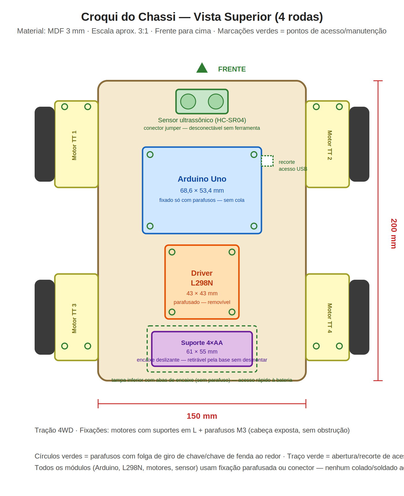
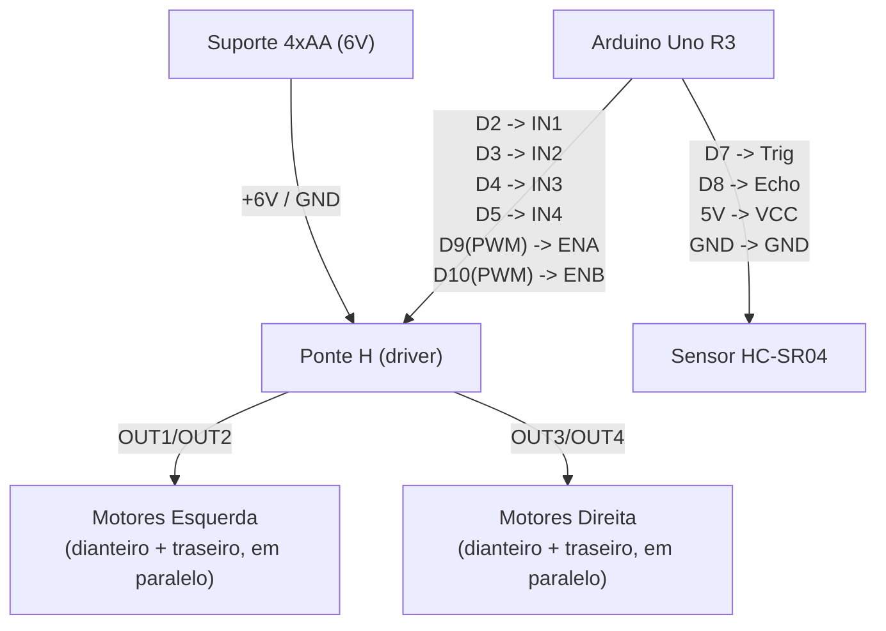
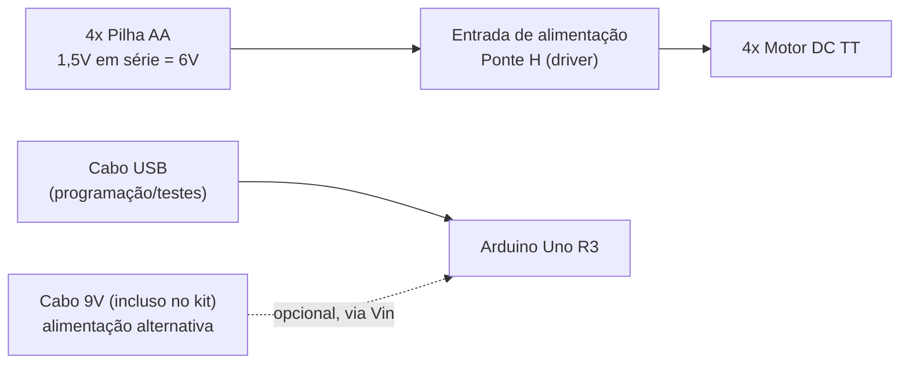

> **Histórico da Etapa 1 (chassi e planejamento).** Este documento foi escrito antes da montagem. A **pinagem e o driver reais** estão em `hardware/esquema_ligacao.md` (driver confirmado: módulo **L298N HW-095**; fiação: IN1=D12, IN2=D10, IN3=D2, IN4=D4, ENA=D11, ENB=D3, Trig=D6, Echo=D7). A tabela abaixo ficou desatualizada.

# 🚗 Projeto Carrinho — Maker Lab

Documentação do desenvolvimento de um carrinho robótico 4x4 controlado por Arduino, construído na disciplina de Maker Lab.

## 📖 Visão Geral do Projeto

**O que é:** um carrinho robótico de 4 rodas motorizadas (4WD), controlado por um Arduino Uno, capaz de se locomover de forma autônoma e desviar de obstáculos usando um sensor de distância ultrassônico.

**Funcionalidades:**
- Movimentação para frente, para trás e curvas, por controle independente da velocidade dos motores de cada lado (tração diferencial)
- Detecção de obstáculos à frente por meio do sensor ultrassônico HC-SR04
- Desvio automático de obstáculos durante a locomoção
- Alimentação autônoma por bateria, sem depender de cabo de energia externo durante o funcionamento

**Objetivo a ser alcançado:** aplicar na prática os conceitos de eletrônica, mecânica e programação vistos em Maker Lab, construindo um robô funcional desde a etapa de projeto (requisitos, dimensionamento) até a montagem física e a programação do comportamento autônomo.

> **Atualização de escopo:** o grupo decidiu utilizar um **kit de chassi 4WD pronto (acrílico, dois níveis)** em vez de fabricar o chassi em MDF sob medida. O kit já vem com chassi, motores, rodas, Arduino, driver de motor e sensor — ver seção 1.5 para detalhes do produto escolhido.

## 👥 Integrantes

| Nome | RM |
|------|-----|
| Paulo Lopes | 551137 |
| Gustavo Melo | 98809 |
| Lucas Bandeira | 98640 |
| Carlos Ganzerli | 99840 |

---

## 📋 Etapa 1 — Chassi

### 1.1 Ficha de Requisitos

| Item | Especificação |
|------|---------------|
| **Chassi** | Kit pronto, acrílico, dois níveis (não fabricado pelo grupo) |
| **Dimensões do chassi** | ~256 × 150 × 65 mm (comprimento × largura × altura, conforme especificação do kit) |
| **Quantidade de motores** | 4 motores DC com caixa de redução 48:1 (motor TT, 3–6 V), inclusos no kit |
| **Rodas** | 4 rodas de borracha, uma por motor (tração 4WD), inclusas no kit |
| **Tração** | Diferencial nos dois lados — curvas por diferença de velocidade entre lado esquerdo e direito |
| **Placa controladora** | Arduino Uno R3 (compatível, ATmega328 SMD) — incluso no kit |
| **Atuadores** | 4x motor DC com caixa de redução (movimento) — nenhum outro atuador previsto nesta etapa |
| **Driver de motores** | Ponte H (anúncio indica "L293N" — a confirmar com o vendedor se é módulo L298N ou shield L293D; ver seção 1.7) |
| **Sensores** | Sensor ultrassônico HC-SR04, com suporte — incluso no kit |
| **Alimentação** | Suporte 4×AA (6 V) para os motores, incluso no kit + cabo 9V incluso (alimentação alternativa do Arduino) |
| **Itens extras do kit** | 4x disco de encoder, kit de espaçadores/parafusos/porcas, mini protoboard, cabo USB, jumpers |

### 1.2 Medidas dos Módulos

> Medidas de referência, baseadas na especificação do anúncio do kit. Confirmar com os módulos físicos do grupo assim que o kit chegar.

| Módulo | Dimensões aproximadas (C × L × A) |
|--------|-----------------------------------|
| Chassi (2 placas de acrílico) | 256 × 150 × 65 mm (conjunto montado) |
| Motor TT (com caixa de redução, incluso no kit) | ~70 × 22 × 18 mm (corpo, sem contar o eixo) |
| Roda de borracha (inclusa no kit) | Ø68 mm aprox. |
| Arduino Uno R3 (compatível, incluso) | 68,6 × 53,4 × ~15 mm (com pinos) |
| Ponte H (driver incluso — confirmar modelo exato) | 43 × 43 × 27 mm (referência, caso seja L298N em módulo) |
| Suporte de baterias 4×AA (incluso) | 61 × 55 × 15 mm |
| Sensor ultrassônico HC-SR04 (incluso, com suporte) | 45 × 20 × 15 mm |

### 1.3 Posição dos Componentes

| Componente | Posição no chassi |
|------------|-------------------|
| Sensor ultrassônico (HC-SR04) | Nível superior, frente, centralizado, voltado para fora |
| Arduino Uno | Nível superior, região central |
| Driver de motor | Nível superior, ao lado do Arduino |
| Motores DC (TT) 1–4 | Entre os dois níveis, um em cada canto |
| Suporte de pilhas 4×AA | Nível inferior, região central |
| Discos de encoder | Acoplados ao eixo de cada motor (uso opcional, não obrigatório no projeto) |

### 1.4 Requisitos de Manutenção e Acesso

Como o chassi agora é um kit pronto, a fixação de cada módulo segue o padrão do próprio kit (parafusos e furos pré-definidos nas placas de acrílico). Mesmo assim, os requisitos abaixo continuam sendo verificados na montagem:

| Requisito | Como é atendido |
|-----------|------------------|
| **Retirar bateria** | Suporte 4×AA fixado no nível inferior, acessível sem remover o nível superior |
| **Acessar USB** | Arduino posicionado próximo à borda da placa superior, com a porta USB voltada para fora |
| **Trocar Arduino** | Fixado com parafusos nos furos pré-cortados da placa — sem cola/solda |
| **Remover driver de motor** | Fixado com parafusos, sem soldas diretas na placa |
| **Substituir motor** | Motores presos nos suportes já integrados ao chassi entre os dois níveis |
| **Acessar parafusos** | A verificar na montagem física — furos do kit já vêm espaçados para uso da chave de fenda |
| **Desconectar sensores** | Sensor ligado por conectores tipo jumper (não soldado) |

### 1.5 Chassi / Kit Escolhido e Arquivo CAD

**Kit escolhido:** [Kit Chassi 4wd Duplo Carro Robô p/ Arduino Educacional NF-e](https://www.mercadolivre.com.br/kit-chassi-4wd-duplo-carro-robo-p-arduino-educacional-nfe/up/MLBU3584307331)

Inclui: chassi acrílico duplo, 4x motor DC 3-6V com redução, 4x roda de borracha, 4x disco de encoder, suporte 4×AA, kit de parafusos/espaçadores, Arduino Uno R3 compatível, cabo USB, ponte H (a confirmar modelo), sensor HC-SR04 com suporte, cabo 9V, mini protoboard e jumpers.

**Croqui de referência (conceitual, do design original em MDF):**

**Modelo 3D de referência (aproximado, dois níveis):**
- [carrinho.stl](carrinho.stl) — modelo 3D para visualização direta no GitHub (abre o visualizador 3D embutido)
- [carrinho.scad](carrinho.scad) — código-fonte editável em OpenSCAD, com as dimensões do envelope do kit (256×150×65mm) e posição estimada dos componentes. **As medidas exatas dos furos serão conferidas assim que o kit físico chegar.**
- Modelo genérico de referência do mesmo padrão de chassi: [4wd Smart Car Chassis Robot Kit (GrabCAD)](https://grabcad.com/library/4wd-smart-car-chassis-robot-kit-1)

### 1.6 Tabela Dimensional dos Componentes

| Componente | Comprimento | Largura | Altura | Forma de Fixação |
|---|---|---|---|---|
| Chassi (2 placas de acrílico) | 256 mm | 150 mm | 65 mm (montado) | Parafusos e espaçadores inclusos no kit |
| Motor DC TT (redução 48:1) | ~70 mm | ~22 mm | ~18 mm | Suporte integrado ao chassi (kit) |
| Roda de borracha | Ø~68 mm | — | — | Encaixe por pressão no eixo do motor |
| Arduino Uno R3 | 68,6 mm | 53,4 mm | ~15 mm | Parafusado nos furos pré-cortados do chassi |
| Ponte H (driver) | 43 mm | 43 mm | 27 mm | Parafusada (confirmar modelo exato — ver 1.1) |
| Sensor Ultrassônico HC-SR04 | ~45 mm | ~20 mm | ~15 mm | Suporte próprio incluso no kit |
| Suporte de pilhas 4×AA | 70 mm | 63 mm | 18 mm | Fixado no nível inferior do chassi |

**Datasheets:**
- [Datasheet ST L298N](https://www.st.com/resource/en/datasheet/l298.pdf)
- [Arduino Uno R3 - specs oficiais](https://docs.arduino.cc/hardware/uno-rev3/)
- [Sensor HC-SR04](https://www.usinainfo.com.br/sensor-ultrassonico/sensor-ultrassonico-de-distancia-hc-sr04-2295.html)

### 1.7 Diagrama de Blocos e Conexões

**Itens utilizados:** Arduino Uno R3, Ponte H (driver de motor), 4x Motor DC TT, Sensor Ultrassônico HC-SR04, Suporte de pilhas 4×AA.

> ⚠️ **Pendente de confirmação:** o anúncio do kit lista o driver como "Shield Ponte H Motor L293N" — provável erro de digitação. Pode ser um módulo L298N (pinagem abaixo, igual à documentada) ou um shield L293D que encaixa sobre o Arduino (pinagem fixa, pode ser diferente). **Confirmar com o vendedor antes da montagem e ajustar esta tabela se necessário.**

**Tabela de conexões (pinos) — válida se o driver for módulo L298N:**

| Origem (Arduino) | Destino | Pino no destino | Função |
|---|---|---|---|
| D2 | Driver | IN1 | Sentido de giro — motores lado esquerdo |
| D3 | Driver | IN2 | Sentido de giro — motores lado esquerdo |
| D4 | Driver | IN3 | Sentido de giro — motores lado direito |
| D5 | Driver | IN4 | Sentido de giro — motores lado direito |
| D9 (PWM) | Driver | ENA | Velocidade — motores lado esquerdo |
| D10 (PWM) | Driver | ENB | Velocidade — motores lado direito |
| D7 | HC-SR04 | Trig | Envia o pulso ultrassônico |
| D8 | HC-SR04 | Echo | Recebe o retorno do pulso (mede distância) |
| 5V | HC-SR04 | VCC | Alimentação do sensor |
| GND | HC-SR04 / Driver | GND | Referência de terra comum a todos os módulos |

> Cada canal do driver aciona 2 motores em paralelo (dianteiro + traseiro do mesmo lado).

### 1.8 Diagrama de Alimentação

**Tipo de bateria escolhida:** suporte de 4 pilhas AA (1,5V cada, ligadas em série = 6V) — incluso no kit escolhido.

**Por que essa opção e não as outras consideradas:**

| Opção avaliada | Motivo de não ter sido escolhida |
|---|---|
| Bateria 9V | Corrente disponível baixa para 4 motores simultâneos; descarrega rápido sob carga de motor |
| Bateria de lítio (Li-ion 18650) | Exige circuito de carga/proteção próprio; presente em outros kits avaliados, mas descartado por custo e risco de manuseio maiores |
| **Pilhas AA (escolhida)** | Tensão (6V) compatível diretamente com a faixa de operação dos motores TT (3–6V), fácil de repor, baixo custo e manuseio seguro em sala de aula — e é o que já vem no kit escolhido |

> O Arduino pode ser alimentado via cabo USB (durante programação/testes) ou pelo cabo de bateria 9V incluso no kit (via entrada Vin), mantendo o circuito de lógica separado do circuito de potência dos motores (que usa exclusivamente as pilhas AA através do driver).

---

## 🔜 Próximas Etapas

- [ ] Receber e conferir o kit (chassi, motores, Arduino, driver, sensor)
- [ ] Confirmar modelo exato do driver de motor (L298N ou L293D) e ajustar diagrama de conexões
- [ ] Montagem mecânica do chassi (kit pronto)
- [ ] Ligação elétrica (Arduino + driver + sensor + alimentação)
- [ ] Programação do controle de movimento
- [ ] Testes e ajustes

## 🛠️ Ferramentas e Materiais

- Chave de fenda / parafusadeira
- Ferro de solda e estanho (se necessário)
- Multímetro

---

*Documentação atualizada em setembro/2026 — Etapa 1: Chassi (kit pronto).*
