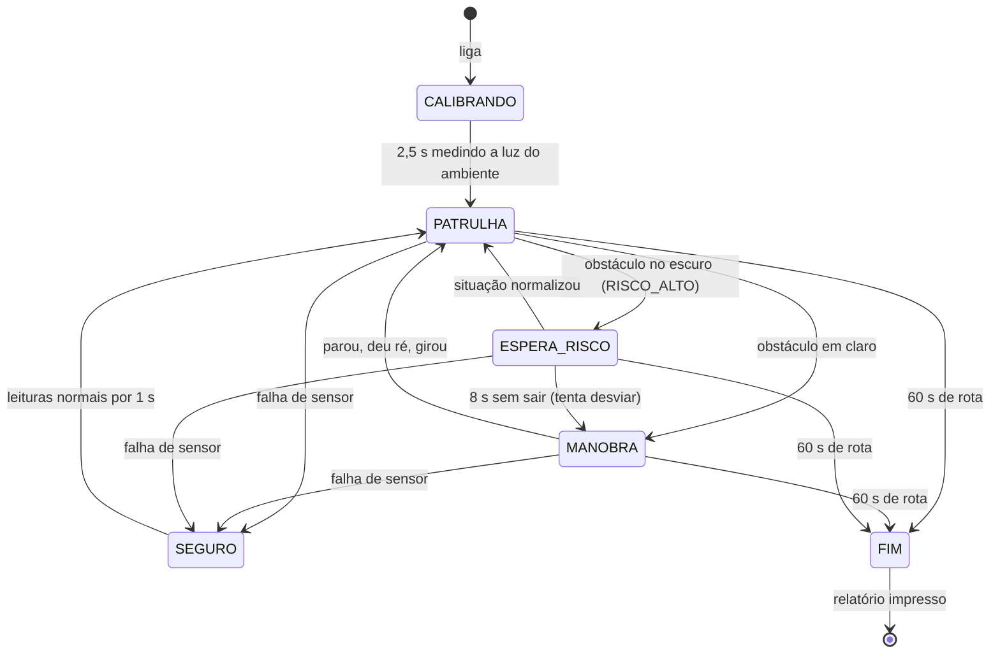

# Máquina de estados

## O que o robô faz e o que o cidadão percebe

| Situação | Condição | Motores | LED | Buzzer |
|---|---|---|---|---|
| LIVRE | Sem obstáculo, luz normal | Anda a 255 | Verde | Mudo |
| ESCURO | Luz abaixo de 50% da referência | Anda a 190 (devagar) | Amarelo | 1 bip curto ao entrar |
| OBSTACULO | Distância ≤ 20 cm em claro | Para, ré, pausa, gira (alterna o lado) | Vermelho | 2 bips ao entrar |
| RISCO_ALTO | Obstáculo **e** escuro | Para | Vermelho piscando | Alarme contínuo |
| FALHA (modo seguro) | LDR desconectado ou Echo preso (e sem eco prolongado, se ativado) | Para | Todos piscando | 3 bips e pausa, repetindo |
| FIM | 60 s de rota | Para | Verde piscando | 1 bip longo e relatório |

A **decisão** (a coluna "Condição") está em `firmware/calcada_livre/logica.h` e é testada no PC. O **comportamento** (as demais colunas) está no `.ino` e é testado com um Arduino simulado.

## Funcionalidades de acessibilidade
- **Padrões sonoros diferentes** para cada situação: quem tem baixa visão distingue "escuro" (1 bip), "obstáculo" (2 bips), "risco" (contínuo) e "falha" (3 bips) sem olhar para os LEDs.
- **LEDs em três cores** (verde, amarelo, vermelho) para quem escuta mal. Sem os LEDs externos, `LEDS_COMPLETOS 0` usa só o LED da placa.
- **Relatório da rota** no fim: quantos obstáculos, trechos escuros e riscos altos foram encontrados.
